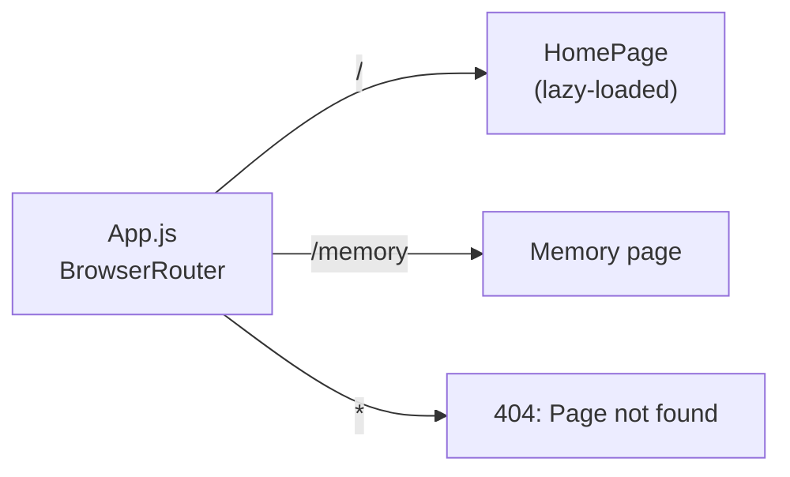
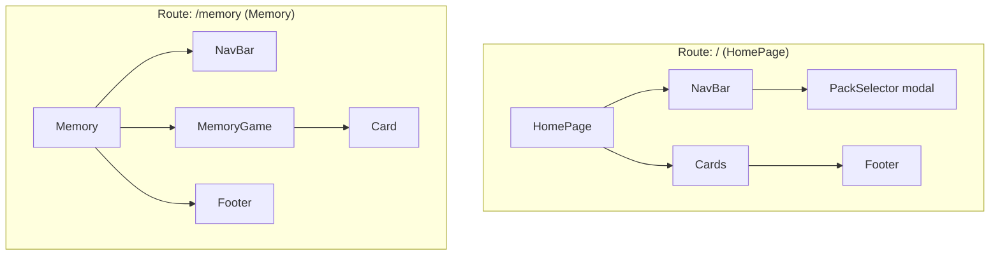
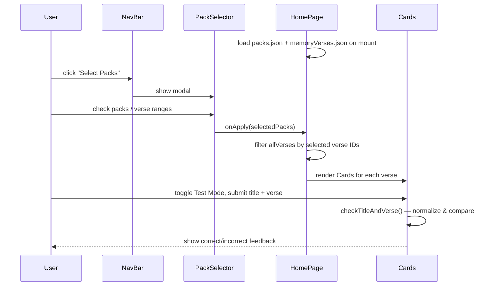
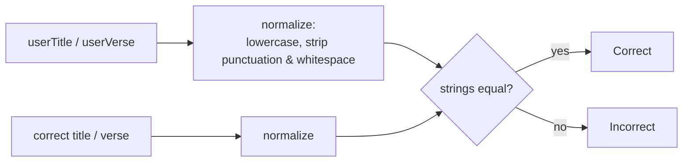

# Architecture & Code Overview

Technical documentation for **Review Scripture** — a client-only React SPA for memorizing Bible verses by topical pack, with a flashcard/test mode and a memory-match game.

## Tech Stack

- **React 18** (Create React App / `react-scripts`)
- **react-router-dom v6** — client-side routing, lazy-loaded routes
- **react-bootstrap** / Bootstrap 5 — UI components (Navbar, Modal, Form, Card)
- **Sass** — component-scoped `style.scss` files
- No backend: all verse/pack data ships as static JSON in the bundle; all state is local React state (no Redux/Context/API calls)

## Project Structure

```
src/
├── App.js                        # Router root
├── components/
│   ├── Cards/                    # Flashcard (view + test mode)
│   ├── Footer/                   # Static footer
│   ├── Memory/                   # Memory-match game (Card, MemoryGame)
│   ├── NavBar/                   # Top nav + PackSelector modal
│   │   └── PackSelector/
│   └── pages/
│       ├── Home/HomePage.jsx     # "/" route
│       └── Memory/Memory.jsx     # "/memory" route
├── mocks/MockVerses.js
├── resources/
│   ├── memoryVerses.json         # Verse data
│   └── packs.json                # Pack names
└── utils/
    ├── checkSM.js                # Answer-checking logic
    └── checkSM.test.js
```

## Routing



## Component Tree



## Data Model

`resources/packs.json` — list of named packs:

```json
{ "id": 1, "packs": "TMS 60" }
```

`resources/memoryVerses.json` — one entry per verse:

```json
{
  "id": 1,
  "pack": "5 Assurances",
  "memory_pack": "5 Assurances",
  "pack_description": "Lessons on Assurance",
  "reference": "1 John 5:11-12",
  "verse": "And this is the testimony: ...",
  "title": "Assurance of Salvation"
}
```

Both files are imported directly as JS modules (no fetch/API) and held in component state, filtered on the client.

## HomePage Data Flow (Flashcards)



## Answer Checking (`utils/checkSM.js`)

`checkTitleAndVerse` lowercases, strips punctuation, and strips whitespace from both the user's input and the correct title/verse, then does an **exact string comparison** (no partial credit):



> `findLCS` / `findLongestCommonSubsequence` exist in the same file but are dead code (commented out) from an abandoned partial-credit/diff scoring attempt.

## Memory Game (`components/Memory`)

```mermaid
flowchart TD
    V[verses prop] --> GC["generateCards():<br/>build card for every reference + every title, shuffle"]
    GC --> Grid[Render card grid]
    Grid --> Click[User clicks a card]
    Click --> Flip[Flip card, add to flippedCards]
    Flip --> Two{2 cards flipped?}
    Two -->|no| Grid
    Two -->|yes| Match{card values equal?}
    Match -->|yes| Matched[Mark matched, increment matchedPairs]
    Match -->|no| Reset[Unflip after 1s]
    Matched --> Win{all pairs matched?}
    Win -->|yes| WinMsg[Show "You Won!"]
    Win -->|no| Grid
```

## Known Issues / Dead Code

| Area | Issue |
|---|---|
| `MemoryGame.resetGame()` | Calls `generateCards()` with no arguments — `generateCards` requires `verses`, so clicking "Play Again" will throw. |
| `MemoryGame` match logic | Cards are built from `[...references, ...titles]` and matched by identical `value`. A reference can only match an identical reference (and likewise for titles) — a title can never match its corresponding reference, so the game as built cannot be won by matching title↔reference pairs. |
| `Memory.jsx` score | `score` passed to `NavBar` is hardcoded `0`; `setScore` is commented out — no scoring on this page. |
| `checkSM.js` | Contains large commented-out LCS/diff-based scoring logic, unused. |
| Data duplication | `pack` and `memory_pack` fields in `memoryVerses.json` appear redundant. |

## Build & Scripts

See the root [README.md](../README.md#available-scripts) for `npm start` / `npm test` / `npm run build`.
